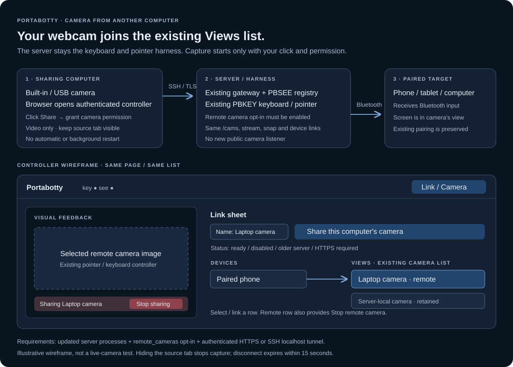

# Portabotty: hook up a browser camera

A camera attached to the computer you are using can join Portabotty's **existing Link → Views list**. Portabotty's server remains the keyboard/pointer harness and sends input to its paired target over Bluetooth. The camera belongs to the sharing computer; it does not need to be plugged into the server.

**Run Portabotty only on the Linux host.** The source computer uses its browser and needs no Portabotty process or sharing-app installation. Keep that browser tab open. Every Cam/gateway restart and `pbsee.json` setting in this guide belongs to the Linux host.



## Connect

1. On Linux, restart the existing PBKEY (`pb`), gateway and camera processes from the updated checkout. For PBRELAY, update `relay.py` on the relay as well. Do not start a second competing instance.
2. Opt in on that server: merge `"remote_cameras": true` into its existing `pbsee.json`, preserving its other settings, and restart Cam. The one-run alternative is `see serve --allow-remote-cameras`.
3. On the computer with the webcam, open the authenticated controller over existing HTTPS, or over your authenticated SSH localhost tunnel. For a server/account you already trust:

   ```sh
   ssh -N -o ExitOnForwardFailure=yes -L 127.0.0.1:18800:127.0.0.1:8800 USER@SERVER
   ```

   Open `http://localhost:18800/` with your existing controller token. A raw LAN HTTP address does not provide the browser's required secure context. No additional server port or firewall exception is needed.
4. Click the visible **Link / Camera** button. In the Link sheet, name the source and click **Share this computer's camera**. Only then grant browser camera permission. Select the camera using the browser's camera chooser/settings. No audio or screen capture is requested.
5. Its remote row appears in **Views** beside server-local cameras. Link a device to that row or select it for feedback. Keep the source tab visible. The keyboard/pointer path stays the same.

## Stop

Use the persistent **Stop sharing** banner on the source, or **Stop remote camera** in its Views row. Hiding/closing the source tab, permission ending, or an upload failure stops capture. The server revokes a disconnected source after 15 seconds and clears its cached image. It never restarts capture by viewing a row; sharing must be started again on the source computer.

## If the control is missing or unavailable

| What you see | Meaning and smallest next step |
| --- | --- |
| No Share button inside Link | The new HTML always includes it, even when disabled. Confirm the URL and deploy/restart the actual gateway; reload the page afterward. |
| “Start the camera service on the Linux host” | Start/reconnect the existing Linux camera process. This message does not request camera permission. |
| “Restart the camera service on the Linux host” | The running Linux camera process does not report browser publishing support; restart it from the updated checkout. |
| “Check the camera service connection on the Linux host” | The camera port is reachable but its status could not be read. Check the existing Linux gateway-to-camera connection and authentication. |
| “Enable remote_cameras on the Linux host” | Browser publishing is off. Enable the Linux camera process's `remote_cameras` setting and restart that process. |
| HTTPS/SSH message | Open the source browser through a secure context and local proxy/tunnel. Do not bypass a certificate warning. |

Optional **Connection details** in the Link sheet shows web and camera build IDs. An authenticated `GET /version` identifies the loaded gateway without contacting a camera. Normal setup shows the actions needed, without version-history explanations.

The feature uses the existing controller and camera authentication, plus an in-memory publishing token scoped to the source. The endpoint accepts only a local tunnel/TLS-proxy peer and checks browser Origin when present. TLS proxies must preserve Host. PBRELAY must use HTTPS (or a local encrypted tunnel); public plaintext publishing is refused. Credentials and footage are not saved by this feature.

## Verification and remaining access

Development checks use synthetic JPEGs, mocked device discovery/input and blocked capture subprocesses. Browser lifecycle checks use fake media tracks. They do **not** establish a successful physical-camera hookup.

Before testing a camera, check the controller's authenticated `/version` endpoint. A source update only takes effect after the process that owns the gateway has restarted; Cam is a separate process and must also run the updated file. Then reload the browser page. A successful `git pull` cannot update Python code already loaded by a running process.

Real-device validation requires your known Linux server/account, authenticated controller URL, browser camera permission and paired target. Confirm the image, existing Views link, Stop, disconnect and manual restart. Synthetic tests do not establish a successful physical-camera hookup.
